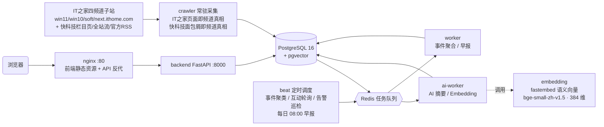

<div align="center">

# 📡 华军软件园资讯雷达系统

**多源科技资讯聚合 · AI 摘要 · 热点事件聚类 · 热度排行 · 每日 08:00 今日早报**


</div>

---

## 项目简介

华军软件园资讯雷达系统是一套面向内部编辑、运营、产品团队的**多源科技资讯聚合与热点分析系统**：从 IT之家与快科技自动采集资讯，经 AI 摘要压缩阅读成本，通过 Embedding 向量聚类把多家媒体的报道归并为同一热点事件，再以热度算法排行、每日 08:00 自动生成「今日早报」。

- **V1 解决**「今天发生了什么？」—— 频道热榜、最新资讯时间轴
- **V2 解决**「这件事是什么？为什么重要？有哪些媒体关注？后续如何发展？」—— AI 摘要、热点事件聚合、多来源关联、今日早报

第一阶段基于 IT之家体系频道（软件之家 / Win11之家 / Win10之家 / 智能时代）与快科技（桌面系统 / 电脑软件 / 移动应用 / 手机系统，2026-09 接入）建设，架构上预留多来源扩展能力。

## ✨ 功能特性

| 模块 | 说明 |
| --- | --- |
| 🔥 **热榜中心** | `HotScore = Engagement × TimeDecay`，纯算法热度、无人工权重；Engagement = 阅读 + 评论×4 + 点赞×2 + 分享×6，零互动时自动降级为时间衰减主导；支持 24h / 3d / 7d / 全部四档时间窗，窗口筛选、排序与 0-100 归一化全部在服务端完成 |
| 📰 **最新资讯** | 按发布时间倒序的实时资讯流，支持频道筛选、标题/标签检索与「加载更早」分页 |
| 🤖 **AI 摘要** | 一句话摘要 + 3~5 条核心信息 + 标签提取；支持任意 **OpenAI 兼容 LLM**，未配置时自动降级为内置 TextRank v2 抽取式摘要（句图 PageRank + MMR 去冗余），双模式对上层透明 |
| 🧩 **热点事件聚合** | 本地语义向量服务（fastembed + bge-small-zh-v1.5，384 维）+ **三段式聚类门槛**（相似度带 × 标题关键词 × 跨来源佐证，同来源一律不并高位带）+ 48h 时间窗 + 事件级二阶段合并，多来源报道归并为一个事件，附事件时间线与相关报道 |
| 📅 **今日早报** | 每日 08:00 自动生成**当日发布期刊**（早报定位：速览「昨夜今晨」，统计窗口昨日 00:00 → 发布日 08:00，overnight 报道归当期不顺延，每篇报道恰好归属唯一一期，期号幂等）：早报综述、今日头条、昨夜今晨热点事件、事件摘要、行业变化、热点速览（自动剔除 TOP 事件成员防同事件重复）、早报窗口 AI 成本，刊头带星期标注；**错峰补偿**——本地 PC 关机/休眠错过 08:00 调度时，每小时 :45 自动补生成缺失期（历史回看 3 天，今天 08:00 后；补算不推送、advisory lock 幂等）；支持复制 Markdown / 打印导出 PDF / 期号对比；生成后自动推送**企业微信 + 飞书**双通道（企微为 markdown 卡片，含「今日头条」栏目；飞书为简洁文本早报——刊头（问候 + 日期·星期）+ 早报速览 ❶~❿ 逐条「标题：一句说明」（事件优先、速览/热榜增量补位去重）+ 品牌·期号落款；运维监控面板「早报推送」热配置，飞书可选签名校验） |
| ✍️ **公众号草稿（AI 生文）** | 编辑在热点事件详情 / 资讯详情选择「生成公众号稿」，基于事件多来源报道或单篇正文生成公众号专用文章（快讯版/深度版，标题+备选+120 字摘要+Markdown 正文）；可编辑、重生成、白底预览，复制富文本后人工粘贴公众号编辑器；自动补齐来源，用量 `article`。 |
| 🌐 **网站资讯稿（独立板块）** | 在相同选题处选择「生成网站稿」，由另一套提示词生成网站标题、内容简介、相关页面关键字、栏目标签、正文和标题图片构图建议；置顶/推荐/头条、软件 ID、发布时间和 1:1 标题图片由人工决定。逐字段复制粘贴到 CMS，不会自动发布；保留来源，成本流水 `site_article`。两套草稿列表/详情/API 按频道隔离，旧稿仍是公众号。详见 [网站资讯稿使用说明](docs/网站资讯稿使用说明.md)。 |

| 💰 **AI 用量与成本看板** | LLM / Embedding 的 token 消耗、按模型价目表（含缓存价）核算成本、未计价模型盲区告警、近 7 天日均与月末成本预估、30 天北京时间趋势整日桶、日预算超限告警、流水保留期自动清理、调用流水明细（含连通性测试落账）、CSV 导出（可带筛选，超管专属） |
| 🛠️ **运维监控面板** | 基础设施连通性（DB/Redis/Celery）、任务执行记录（含 **degraded 降级态**）与任务节奏心跳（停摆感知）、互动数据轮询水位、告警 Webhook（企业微信/钉钉/飞书，每 5 分钟巡检）、**运行时配置热更新**（DB 覆盖 > .env，保存即生效无需重建）、LLM/Embedding 连通性测试 |
| 🌗 **界面主题** | 浅色 / 深色 / 跟随系统三态切换（顶栏与移动端抽屉均可切换）；浅色为 **macOS 设计语言**（Apple 灰窗体 + 白卡悬浮 + 蓝色 accent + 毛玻璃顶栏）；偏好本地持久化、刷新不丢失，「跟随系统」实时响应操作系统深浅色变化 |
| 🔑 **登录与多租户权限** | 全站强制登录（**邮箱 + 密码**，无注册，账号由管理员后台创建）；多租户三级 RBAC（平台超管 / 租户管理员 / 成员）；服务端会话（HttpOnly Cookie，即时吊销）+ 登录失败锁定 + 登录 IP 限速 + 会话空闲超时 + 首登强制改密；完整审计日志（登录/管理操作留痕，**SHA-256 哈希链防篡改**，超管可查可导出，自动清理） |

两板块草稿沿用全员共享政策：登录成员可查看、编辑、重新生成和删除任意草稿，`created_by` 仅供审计追溯，不是租户/用户隔离。两板块共用 `article_gen_enabled`、模型和单用户每小时额度，关闭生成开关会阻止尚未发出的调用并将对应代次标记为失败；已发出的模型请求不会被取消，结果允许完成。公众号人工编辑标题最多 30、摘要最多 120 个 Unicode 码点；网站稿标题上限 80、内容简介上限 160（均为工具保存上限，非搜索引擎硬性规则）。保存时标题、简介去除首尾空白；历史草稿不批量裁剪。原始单篇资讯若已清理，将无法从旧稿重新打开来源。

草稿队列对子进程丢失的恢复只处理 `article_gen_task` 和 `site_article_gen_task` 的 Celery 失败信号：仅针对带显式 generation 的 `WorkerLostError`，并以 PostgreSQL 同稿 advisory lock、`generating` 状态和 generation 条件更新；全局 `task_reject_on_worker_lost` 保持关闭，避免毒任务无限即时重投。锁重试耗尽时也只在确认没有活动 owner 后标记失败；合法同稿生成仍持锁时，草稿继续 generating，并安排一次 3605 秒后的安全确认（超过 1 小时硬时限），确认任务再次校验锁和代次。父进程与数据库同时故障、确认任务无法入队/执行、或 hard time limit 未产生 `WorkerLostError` 时，仍需使用现有 stale 人工/API 重试入口。生产 Redis visibility timeout 仍为 4 小时；诊断测试缩短值仅用于隔离环境，不代表生产恢复时延。

## 🏗️ 系统架构



| 服务 | 职责 |
| --- | --- |
| `backend` | FastAPI REST API（容器内 8000，宿主机映射 `127.0.0.1:18000`） |
| `crawler` | 常驻循环：多来源采集（IT之家页面即频道真相 / 快科技文章页面包屑即频道真相）→ 入库 → 派发 AI 任务；心跳文件供健康检查 |
| `worker` | Celery 默认队列：事件聚合 / 早报生成 |
| `ai-worker` | Celery AI 队列：摘要 / Embedding |
| `beat` | 定时调度：事件聚类（10 分钟）、互动数据轮询（15 分钟）、告警巡检（5 分钟）、每日 08:00 生成当日发布期刊、早报补偿（每小时 :45，错过调度的缺失期自动补生成）、每周清理 |
| `embedding` | 本地语义向量服务（docker-compose.override.yml 自动合并）：fastembed(ONNX) + BAAI/bge-small-zh-v1.5，OpenAI 兼容 `/v1/embeddings`，免 GPU、模型经镜像站缓存于卷 |
| `postgres` | 业务数据 + pgvector 向量检索 |
| `redis` | 缓存 + Celery 消息队列 |
| `nginx` | 前端静态资源 + `/api` 反向代理（唯一公网入口，动态 resolver，backend 单独重建不 502） |

## 🚀 快速开始

**前置要求**：Docker 20+ 与 Docker Compose v2

```bash
git clone https://github.com/xuboboo/news.git   # ⚠️ 该仓库 2026-09-19 实测可匿名 clone（公开可见），与文末「内部私有项目」声明冲突，上线前请在 GitHub 仓库设置改为 Private
cd news
cp backend/.env.example backend/.env   # 按需修改 ADMIN_TOKEN 等配置
echo "POSTGRES_PASSWORD=<强随机口令>" > .env   # 根 .env 为必需：compose 建库口令，缺失拒起
docker compose up -d --build           # 一键上线全套 9 个服务（含 override 合并的语义向量服务）
```

启动后的访问入口：

| 入口 | 地址 |
| --- | --- |
| 前端站点（含 API 反代） | http://localhost |
| 后端 API | http://127.0.0.1:18000 |
| OpenAPI 交互文档 | http://127.0.0.1:18000/docs |
| 运维监控面板 | http://localhost/admin |

## ⚙️ 配置说明

配置位于 `backend/.env`（模板见 `backend/.env.example`），标 ★ 的键均可在管理面板「运行时配置」中热覆盖（DB 优先于 .env，保存即生效；传空串 = 回落 .env 默认值）。

**基础设施**

| 变量 | 说明 |
| --- | --- |
| `ENVIRONMENT` | `production` 时启动执行安全自检（Cookie Secure / 关闭文档 / 关闭免鉴权 / 非默认 DB 口令任一不合规即拒绝启动） |
| `DATABASE_URL` / `REDIS_URL` | PostgreSQL 连接串（业务库）/ Redis 连接串（缓存/队列） |
| `POSTGRES_PASSWORD` | compose 建库口令（**项目根目录 `.env` 必填，无默认值、缺失拒起**；首次建库生效，轮换步骤见 `.env.example` 检查单） |
| `ENABLE_DOCS` | OpenAPI 交互文档开关（默认 true；生产强制 false） |

**AI 服务（可选，OpenAI 兼容协议）**

| 变量 | 说明 |
| --- | --- |
| `LLM_BASE_URL` ★ / `LLM_API_KEY` ★ / `LLM_MODEL` ★ | 配置后 AI 摘要与事件总结走大模型；不配置自动降级内置 TextRank v2 |
| `EMBEDDING_BASE_URL` ★ / `EMBEDDING_API_KEY` ★ / `EMBEDDING_MODEL` ★ | 接入 embedding-server 时为 `http://embedding:80/v1` / `local-embedding` / `BAAI/bge-small-zh-v1.5` |
| `EMBED_DIM` | 向量维度（内置哈希向量默认 256；用 embedding-server 须为 384，与模型实际输出一致，严格模式下不符即硬失败） |
| `EMBEDDING_STRICT` | Embedding 失败/维度不符时是否硬失败（false 会静默降级本地哈希向量、污染聚类）；仅 .env，不进面板 |
| `AI_URL_ALLOWLIST` | 内网服务主机名精确白名单（逗号分隔，如 `embedding`）：仅这些主机豁免 SSRF 私网校验；`ALLOW_PRIVATE_AI_URLS` 已弃用（全局豁免，production 禁用）。均仅 .env，不进面板 |

**事件聚合与采集**

| 变量 | 说明 |
| --- | --- |
| `SIM_THRESHOLD` ★ / `KEYWORD_JACCARD_THRESHOLD` ★ / `HIGH_BAND_KW_FLOOR` ★ | 事件聚类基础相似度阈值（默认 0.85）/ 标题关键词重合门槛（模糊带，默认 0.2）/ 高位带最低关键词重合（默认 0.1，须跨来源） |
| `CLUSTER_WINDOW_HOURS` / `CLUSTER_LOOKBACK_HOURS` ★ | 聚类时间窗（默认 48h，仅 .env）/ 每轮回看窗（默认 96h，可热调） |
| `CRAWLER_INTERVAL_MINUTES` ★ / `CRAWL_LIMIT_PER_FEED` | 采集间隔（分钟，热调立即生效）/ 单源单轮抓取上限 |
| `STATS_POLL_ENABLED` ★ / `STATS_POLL_BATCH` ★ | 互动数据轮询总开关 / 批次大小（IT之家 + 快科技的评论数与点赞数，分层衰减节奏） |

**早报推送与告警（推荐直接在面板配置）**

| 变量 | 说明 |
| --- | --- |
| `REPORT_PUSH_ENABLED` ★ + `REPORT_PUSH_WECOM_WEBHOOK_URL` ★ | 企业微信机器人推送（日报生成后异步投递，失败自动退避重试；旧变量 `REPORT_PUSH_WEBHOOK_URL` 仍兼容） |
| `REPORT_PUSH_FEISHU_WEBHOOK_URL` ★ / `REPORT_PUSH_FEISHU_SECRET` ★ | 飞书机器人推送 / 可选签名校验密钥 |
| `ALERT_WEBHOOK_URL` ★ / `ALERT_WEBHOOK_STYLE` ★ | 运维告警 Webhook（每 5 分钟巡检 Redis/Worker/任务停摆，状态转坏/恢复才推送；格式 wecom/dingtalk/feishu/raw） |

**AI 成本治理（推荐直接在面板配置）**

| 变量 | 说明 |
| --- | --- |
| `AI_DAILY_COST_BUDGET` ★ | 单日（北京时间日界）AI 成本预算（元）；当日计费超限经告警 Webhook 推送，跨日自动解除；0 = 关闭 |
| `AI_USAGE_RETENTION_DAYS` ★ | AI 用量流水保留天数（默认 365，beat 每周自动清理超期行）；0 = 永久保留，归档先用成本看板导出 CSV |

**登录与会话**

| 变量 | 说明 |
| --- | --- |
| `BOOTSTRAP_ADMIN_EMAIL` / `BOOTSTRAP_ADMIN_PASSWORD` | 首启引导：user 表为空时自动创建「默认租户 + 平台超管」；建号后可移除 |
| `SESSION_TTL_HOURS` ★ / `SESSION_IDLE_HOURS` ★ | 会话绝对有效期（模板 168h=7 天）/ 空闲超时（默认 24h，0=关闭） |
| `LOGIN_MAX_ATTEMPTS` ★ / `LOGIN_LOCK_MINUTES` ★ | 登录失败锁定阈值（5 次）/ 锁定时长（15 分钟） |
| `LOGIN_IP_THROTTLE_MAX` ★ / `LOGIN_IP_THROTTLE_WINDOW_SECONDS` ★ | 登录 IP 限速：窗口内最大尝试次数（默认 30 次）/ 窗口时长（默认 300 秒）；成功登录清零 |
| `COOKIE_SECURE` ★ | 会话 Cookie Secure 标记，HTTPS 部署必须 `true`（production 强制校验） |
| `AUDIT_RETENTION_DAYS` ★ | 审计日志保留天数（默认 180，beat 每周自动清理） |

**管理面板与安全**

| 变量 | 说明 |
| --- | --- |
| `ADMIN_TOKEN` ★ | 管理接口应急后门 Token（脚本/回归用，敏感键面板脱敏显示）；未设置时后门不可用（503） |
| `ADMIN_NO_AUTH` | 免鉴权开关，**仅限本机/内网**；公网部署必须为 `false`（production 强制校验） |
| `CORS_ORIGINS` | 允许跨域的前端来源白名单，勿用 `*` |

## 📡 API 概览

| 方法 | 路径 | 说明 |
| --- | --- | --- |
| GET | `/api/v2/health`（`?deep=1` 深度探测） | 健康检查（公开，唯一免登录探针；deep 追加 Redis/Celery/采集新鲜度） |
| GET | `/api/v2/hot/board?window=24h\|3d\|7d\|all&channel=` | 热榜中心（服务端排序 + 窗口内归一化） |
| GET | `/api/v2/articles/latest?channel=&q=&limit=&offset=` | 最新资讯（时间倒序 + 检索 + 分页） |
| GET | `/api/v2/article/{id}` / `/api/v2/article/{id}/summary` | 文章详情（内嵌 summary 与 eventIds）/ **AI 摘要** |
| GET | `/api/v2/events?limit=&offset=&status=&q=` / `/api/v2/events/{id}` | 热点事件列表（分页 + 过滤）/ 事件详情（时间线、相关报道、来源分布） |
| GET | `/api/v2/report/daily?date=` / `/api/v2/report/dates` | **今日早报** / 期号列表 |
| GET | `/api/v2/stats` | 系统统计（需登录） |
| POST | `/api/v2/auth/login` · `/auth/logout` | 登录 / 登出（HttpOnly 会话 Cookie，IP 限速 + 失败锁定） |
| GET | `/api/v2/auth/me` · GET `/auth/sessions` | 当前用户 / 我的活跃会话 |
| PUT | `/api/v2/auth/me/password` · DELETE `/auth/sessions/{id}` · POST `/auth/sessions/revoke-others` | 修改密码 / 吊销会话 / 登出其他设备 |
| GET/POST | `/api/v2/admin/tenants` · PUT `/admin/tenants/{id}` | 租户管理（超管；停用有防自锁护栏并即时吊销会话） |
| GET/POST | `/api/v2/admin/users` · PUT `/admin/users/{id}` | 用户管理（超管全局 / 租户管理员限本租户 member） |
| POST | `/api/v2/admin/users/{id}/password-reset` · `/admin/users/{id}/unlock` | 重置密码（强制首登改密）/ 解除登录锁定 |
| GET | `/api/v2/admin/audit-logs` · `/audit-logs/export` · `/audit-actions` | 审计日志查询（超管，哈希链防篡改）/ CSV 导出 / 动作清单 |
| GET/POST | `/api/v2/admin/crawl` · `/admin/events` · `/admin/stats` · `/admin/report` | 手动触发：采集 / 事件聚类 / 互动轮询 / 早报（需超管会话或 Token） |
| GET/PUT | `/api/v2/admin/config` | 运行时配置热更新（敏感值脱敏，留空 = 不修改） |
| POST | `/api/v2/admin/test/llm` · `/test/embedding` | AI 连通性测试（可先验证未保存的 key 再存） |
| GET | `/api/v2/admin/status` · `/admin/task-runs` | 运维总览（含任务节奏心跳、轮询水位）· 任务执行记录 |
| GET | `/api/v2/admin/usage/summary` · `/usage/logs` · `/usage/export` | AI 成本汇总 · 调用流水 · CSV 导出（超管） |
| GET/POST | `/api/v2/admin/usage/prices` | 模型价目表（每百万 token，含缓存价） |

## 🗂️ 目录结构

```
news/
├── backend/
│   ├── app/
│   │   ├── api/v2/        # REST 接口（业务 + auth + admin + 审计）
│   │   ├── auth/          # 会话/密码/限速/CSRF 依赖
│   │   ├── models/        # article / summary / event / daily_report / task_run / usage / user / tenant / session / audit_log / setting（11 表）
│   │   ├── services/      # 摘要、向量、事件、早报、推送、告警、审计（哈希链）、用量成本、配置热更
│   │   ├── algorithms/    # hot_score：HotScore = Engagement × TimeDecay（含 SQL 表达式一致性）
│   │   ├── ai/            # summary（LLM/TextRank v2）/ embedding（API/本地哈希）/ event_cluster（三段式门槛）
│   │   ├── tasks/         # Celery：summary / embedding / event / report / stats / alert / 清理
│   │   ├── crawler/       # 多来源采集：IT之家频道页（ithome）+ 快科技面包屑过滤（mydrivers）+ 调度（multi）+ 常驻循环（loop）+ 互动轮询（stats）
│   │   ├── core/          # 配置（含生产 fail-fast 自检）、数据库
│   │   └── utils/         # 中文文本处理（jieba）、URL 安全守卫（SSRF）、Redis 锁
│   ├── scripts/           # 运维脚本（初始化、重嵌入、数据修复、审计校验、用户管理、聚类标定等 17 个）
│   ├── tests/             # pytest 测试（离线 SQLite + pgvector 集成，本地 venv 运行，不入镜像）
│   └── .env.example       # 配置模板（含生产部署检查单）
├── frontend/              # React 18 + TypeScript + Vite + Tailwind（HashRouter）
│   └── src/pages/         # 热榜 / 最新 / 事件 / 早报 / 成本看板 / 运维监控 / 用户与租户 / 审计 / 账号 / 登录
├── embedding-server/      # 本地语义向量服务：fastembed + bge-small-zh-v1.5（384 维，OpenAI 兼容）
├── docs/                  # 审计报告与整改清单、运维笔记
└── docker-compose.yml     # 8 服务编排 + override 追加 embedding（共 9 个）
```

## 👤 账号与登录

全站强制登录：未登录访问任何页面会跳转登录页（`/health` 等基础设施探针除外）。账号**无注册入口**，全部由管理员后台创建（用户与租户页 → 新建用户），初始密码一次性线下发放，**首次登录强制修改**。

- **角色**：`super_admin` 平台超管（租户/用户/审计/运维/成本全部可见）→ `tenant_admin` 租户管理员（本租户内管理成员）→ `member` 成员（热榜/最新/事件/早报只读）
- **会话**：HttpOnly Cookie（SameSite=Lax，模板默认 7 天），改密/停用/登出即时吊销；空闲超时默认 24h；连续失败 5 次锁定 15 分钟；单 IP 登录限速 30 次/5 分钟（成功登录清零，NAT 不连坐）
- **审计**：登录成功/失败/锁定、用户与租户变更、配置修改、手动触发任务、越权访问全部留痕（操作者/IP/UA/时间），行间 **SHA-256 哈希链**可离线校验篡改；超管在「审计日志」页可查可导出，保留 180 天自动清理
- **忘记超管密码**：`docker compose exec backend python scripts/manage_user.py reset-password <邮箱> <新密码>`

## 🔧 常用运维命令

```bash
docker compose ps                                      # 服务状态
docker compose logs -f crawler worker ai-worker        # 流水线日志
docker compose exec backend python scripts/init_db.py  # 初始化/补建表
docker compose restart crawler                         # 重启即触发一轮采集
docker compose up -d --build backend                   # 改 .env 后重建生效
docker compose exec backend python scripts/manage_user.py create-super <邮箱>   # 建平台超管
docker compose exec backend python scripts/audit_chain_verify.py                # 审计日志哈希链校验
```

### 测试

```bash
cd backend && pip install -r requirements-dev.txt && python -m pytest tests/ -q   # 后端 pytest（离线 SQLite；pg 集成用例设 TEST_DATABASE_URL=postgresql+psycopg://hjradar:<根.env口令>@127.0.0.1:5433/hjradar，需先 docker compose -f docker-compose.yml -f docker-compose.override.yml -f docker-compose.test.yml up -d postgres 回环映射 5433——2026-09-19 起测试端口拆至 test.yml 不再随 override 自动合并（本机原生 postgres 占了 5432，宿主机侧错开））
cd frontend && npm test                                # 前端 vitest
```

## 🔐 安全须知

- **登录与多租户**：全站强制登录；会话令牌服务端存储（库中仅存 SHA-256，即时可吊销，含空闲超时）；密码 bcrypt(cost 12) + 弱口令封锁表；登录失败锁定 + 单 IP 限速；租户/用户停用即时吊销全部会话（停用租户有「最后启用超管」防自锁护栏）。
- **CSRF 与越权留痕**：变更接口要求 JSON + `X-Requested-With`（双保险，配合 SameSite=Lax Cookie）；`/api/v2/admin/*` 的 403 越权与无效 Token 记审计（同操作者 5 分钟去重）。
- **审计防篡改**：审计行间 SHA-256 哈希链（写路径 advisory lock 串行化），`scripts/audit_chain_verify.py` 可离线校验删改。
- 管理接口（`/api/v2/admin/*`）：super_admin 登录会话，或 `X-Admin-Token` 应急后门（仅等效 admin 前缀，虚拟主体留痕可追溯）；`ADMIN_NO_AUTH=true` 仅限本机/内网调试，公网部署必须关闭。
- **生产 fail-fast 自检**：`ENVIRONMENT=production` 时启动即校验 Cookie Secure / 关闭 API 文档 / 关闭免鉴权 / 非默认 DB 口令，任一不合规拒绝启动。
- `backend` 与 `nginx` 端口均仅绑定 `127.0.0.1`（M-1，2026-09-18）：单机部署默认不向局域网暴露；临时共享（手机等）在 `docker-compose.override.yml` 给 nginx 加 `ports: ["80:80"]` 覆盖并记得用完移除（共享时 `COOKIE_SECURE=true` 需改回 false，否则纯 http 经 IP 访问无法登录）。nginx 覆写 `X-Real-IP`/`X-Forwarded-For` 防审计 IP 伪造，并带强制 CSP（`script-src 'self'`，前端零外部脚本依赖）、nosniff、X-Frame-Options 等安全头；上 HTTPS 时必须 `COOKIE_SECURE=true`。
- **SSRF 守卫**：LLM/Embedding/Webhook 服务地址仅放行公网 http(s)（私网/环回/保留段拒绝）；内网服务用 `AI_URL_ALLOWLIST` 按主机名精确豁免（旧 `ALLOW_PRIVATE_AI_URLS` 全局豁免已弃用，production 启动自检拒绝开启）。
- 敏感键（`api_key` / `admin_token`）接口侧只做脱敏展示、不回传明文；配置修改审计只记「已变更」不记新旧明文；留空即表示不修改。
- 生产部署请遵循 `.env.example` 末尾的检查单：项目根目录 `.env` 配置强随机 `POSTGRES_PASSWORD`（无默认回退，缺失时 compose 直接报错拒起）、同步 `DATABASE_URL`、更换强随机 `ADMIN_TOKEN`、配置 `BOOTSTRAP_ADMIN_*` 完成引导。

## ✅ 质量与验收

- 后端 pytest **337 个用例**（另含 15 个依赖运行中 PG 的集成用例，本机经 docker-compose.test.yml 映射的 127.0.0.1:5433 指 `TEST_DATABASE_URL` 后执行，未设置自动跳过）+ 前端 vitest **13 个用例**，全部通过。测试不在生产镜像内（L-2），用本地 venv 跑。
- 验收脚本（需后端已在 18000 运行）：

```bash
# 常规 API 回归（数据端点需先登录）
AUDIT_EMAIL=... AUDIT_PASSWORD=... python backend/scripts/audit_api.py
# 登录/权限/审计专项（权限矩阵、锁定、会话吊销、CSRF）
AUDIT_EMAIL=... AUDIT_PASSWORD=... python backend/scripts/audit_auth.py
# 应急通道默认未配置（ADMIN_TOKEN 留空，M-3），脚本会自动跳过 token 用例；
# 如需回归该通道，临时导出 ADMIN_TOKEN=... 并同步 system_setting 或重启生效
```

## 🗺️ Roadmap

- 多来源扩展：极客公园、少数派、36氪、爱范儿、InfoQ
- 周报与趋势分析
- 阅读数/分享数数据源（IT之家 hitcount 为只写接口，暂无公开读取通道；快科技 hits/share 与 IT之家量纲不对称，单边启用会系统性虚高，评论/点赞已于 2026-09-10 接入）
- 前端 E2E 测试（Playwright/Cypress，后端为最终权限边界）

---

<sub>版权所有 © 2026 华军软件园 · 本项目为内部私有项目，未授权公开使用与分发（All Rights Reserved）。</sub>
