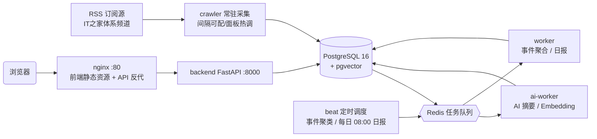

<div align="center">

# 📡 华军科技资讯雷达

**多源科技资讯聚合 · AI 摘要 · 热点事件聚类 · 热度排行 · 每日科技日报**


</div>

---

## 项目简介

华军科技资讯雷达是一套面向内部编辑、运营、产品团队的**科技资讯情报系统**：从 RSS 订阅源自动采集资讯，经 AI 摘要压缩阅读成本，通过 Embedding 向量聚类把多家媒体的报道归并为同一热点事件，再以热度算法排行、每日自动生成科技日报。

- **V1 解决**「今天发生了什么？」—— 频道热榜、最新资讯时间轴
- **V2 解决**「这件事是什么？为什么重要？有哪些媒体关注？后续如何发展？」—— AI 摘要、热点事件聚合、多来源关联、科技日报

第一阶段基于 IT之家体系频道（软件之家 / Win11之家 / Win10之家 / 智能时代）建设，架构上预留多来源扩展能力。

## ✨ 功能特性

| 模块 | 说明 |
| --- | --- |
| 🔥 **热榜中心** | `HotScore = Engagement × TimeDecay`，纯算法热度、无人工权重；互动数据缺失时自动降级为时间衰减主导 |
| 📰 **最新资讯** | 按发布时间倒序的实时资讯流，支持频道筛选与关键词检索 |
| 🤖 **AI 摘要** | 一句话摘要 + 3~5 条核心信息 + 标签提取；支持任意 **OpenAI 兼容 LLM**，未配置时自动降级为内置 TextRank 抽取式摘要，双模式对上层透明 |
| 🧩 **热点事件聚合** | Embedding 余弦相似度 > 0.85 + 标题关键词（jieba）+ 48h 时间窗，多来源报道归并为一个事件，附事件时间线与相关报道 |
| 📅 **科技日报** | 每日 08:00 自动生成**昨日**日报：TOP 热点、事件摘要、行业变化、重点来源 |
| 📊 **AI 用量统计** | LLM / Embedding 的 token 消耗与调用记录 |
| 🛠️ **运维监控面板** | 基础设施连通性（DB/Redis/Celery）、任务执行记录、**运行时配置热更新**（DB 覆盖 > .env，保存即生效无需重建）、LLM/Embedding 连通性测试 |

## 🏗️ 系统架构



| 服务 | 职责 |
| --- | --- |
| `backend` | FastAPI REST API（容器内 8000，宿主机映射 `127.0.0.1:18000`） |
| `crawler` | 常驻循环：RSS 采集 → 入库 → 派发 AI 任务 |
| `worker` | Celery 默认队列：事件聚合 / 日报 |
| `ai-worker` | Celery AI 队列：摘要 / Embedding |
| `beat` | 定时调度：事件聚类、每日 08:00 生成昨日日报 |
| `postgres` | 业务数据 + pgvector 向量检索 |
| `redis` | 缓存 + Celery 消息队列 |
| `nginx` | 前端静态资源 + `/api` 反向代理（唯一公网入口） |

## 🚀 快速开始

**前置要求**：Docker 20+ 与 Docker Compose v2

```bash
git clone https://github.com/xuboboo/news.git
cd news
cp backend/.env.example backend/.env   # 按需修改 ADMIN_TOKEN 等配置
docker compose up -d --build           # 一键上线全套 8 个服务
```

启动后的访问入口：

| 入口 | 地址 |
| --- | --- |
| 前端站点（含 API 反代） | http://localhost |
| 后端 API | http://127.0.0.1:18000 |
| OpenAPI 交互文档 | http://127.0.0.1:18000/docs |
| 运维监控面板 | http://localhost/admin |

## ⚙️ 配置说明

配置位于 `backend/.env`（模板见 `backend/.env.example`），所有键均可在管理面板「运行时配置」中热覆盖（DB 优先于 .env，保存即生效；传空串 = 回落 .env 默认值）。

| 变量 | 说明 |
| --- | --- |
| `DATABASE_URL` | PostgreSQL 连接串（业务库） |
| `REDIS_URL` | Redis 连接串（缓存/队列） |
| `LLM_BASE_URL` / `LLM_API_KEY` / `LLM_MODEL` | 可选，OpenAI 兼容协议；配置后 AI 摘要与事件总结走大模型 |
| `EMBEDDING_BASE_URL` / `EMBEDDING_API_KEY` / `EMBEDDING_MODEL` | 可选，OpenAI 兼容 Embedding 服务 |
| `EMBED_DIM` | 向量维度（内置模式 256；外部服务需与之一致，严格模式下维度不符即硬失败） |
| `SIM_THRESHOLD` / `CLUSTER_WINDOW_HOURS` | 事件聚类阈值（默认 0.85）与时间窗（默认 48h） |
| `CRAWLER_INTERVAL_MINUTES` | 采集间隔，支持面板热调 |
| `ADMIN_TOKEN` | 管理面板鉴权 Token；未设置时管理接口不可用（503） |
| `ADMIN_NO_AUTH` | 免鉴权开关，**仅限本机/内网**；公网部署必须为 `false` |
| `EMBEDDING_STRICT` | Embedding 失败/维度不符时是否硬失败（false 会静默降级本地哈希向量、污染聚类） |
| `ALLOW_PRIVATE_AI_URLS` | 是否允许 LLM/Embedding 地址指向私网/环回 |
| `CORS_ORIGINS` | 允许跨域的前端来源，勿用 `*` |

## 📡 API 概览

| 方法 | 路径 | 说明 |
| --- | --- | --- |
| GET | `/api/v2/hot/board?channel=` | 热榜中心 |
| GET | `/api/v2/articles/latest?channel=&q=&limit=` | 最新资讯（时间倒序 + 检索） |
| GET | `/api/v2/article/{id}` / `/api/v2/article/{id}/summary` | 文章详情 / **AI 摘要** |
| GET | `/api/v2/events` / `/api/v2/events/{id}` | 热点事件列表 / 事件详情（时间线、相关报道） |
| GET | `/api/v2/report/daily?date=` / `/api/v2/report/dates` | **科技日报** / 可用日期 |
| GET | `/api/v2/stats` / `/api/v2/health` | 系统统计 / 健康检查 |
| POST | `/api/v2/admin/crawl` · `/admin/events` · `/admin/report` | 手动触发任务（需 Token） |
| GET/PUT | `/api/v2/admin/config` | 运行时配置（敏感值脱敏，留空 = 不修改） |
| GET | `/api/v2/admin/status` · `/admin/task-runs` | 基础设施状态 · 任务执行记录 |
| POST | `/api/v2/admin/test/llm` · `/test/embedding` | AI 连通性测试（可先验证未保存的 key 再存） |

## 🗂️ 目录结构

```
news/
├── backend/
│   ├── app/
│   │   ├── api/v2/        # REST 接口（业务 + admin）
│   │   ├── models/        # article / article_summary / event / daily_report / task_run / usage
│   │   ├── services/      # 摘要、向量、事件、日报业务服务
│   │   ├── algorithms/    # hot_score：HotScore = Engagement × TimeDecay
│   │   ├── ai/            # summary / embedding / event_cluster（LLM 与内置算法双模式）
│   │   ├── tasks/         # Celery：summary / embedding / event / report
│   │   ├── crawler/       # IT之家 RSS 采集 + 常驻循环
│   │   ├── core/          # 配置、数据库
│   │   └── utils/         # 中文文本处理（jieba）、URL 安全守卫
│   ├── scripts/           # 运维脚本（重嵌入、数据修复、审计等）
│   └── .env.example       # 配置模板
├── frontend/              # React 18 + TypeScript + Vite + Tailwind
│   └── src/pages/         # 热榜 / 最新 / 事件 / 日报 / AI 用量 / 运维监控
└── docker-compose.yml     # 8 服务一键编排
```

## 🔧 常用运维命令

```bash
docker compose ps                                      # 服务状态
docker compose logs -f crawler worker ai-worker        # 流水线日志
docker compose exec backend python scripts/init_db.py  # 初始化/补建表
docker compose restart crawler                         # 重启即触发一轮采集
docker compose up -d --build backend                   # 改 .env 后重建生效
```

## 🔐 安全须知

- 管理接口（`/api/v2/admin/*`）默认要求 `X-Admin-Token` 请求头鉴权；`ADMIN_NO_AUTH=true` 仅限本机/内网调试，公网部署必须关闭并配置强随机 `ADMIN_TOKEN`。
- `backend` 端口仅绑定 `127.0.0.1`，公网入口统一走 nginx(80)。
- 敏感键（`api_key` / `admin_token`）接口侧只做脱敏展示、不回传明文；留空即表示不修改。
- 生产部署请遵循 `.env.example` 末尾的检查单：更换 `POSTGRES_PASSWORD` 强口令、同步 `DATABASE_URL`、更换强随机 `ADMIN_TOKEN`。

## 🗺️ Roadmap

- 多来源扩展：极客公园、少数派、36氪、爱范儿、InfoQ
- 周报与趋势分析
- 接入互动数据源后 HotScore 恢复 `Engagement × TimeDecay` 全量形态

---

<sub>本项目为内部私有项目，未授权公开使用与分发（All Rights Reserved）。</sub>
