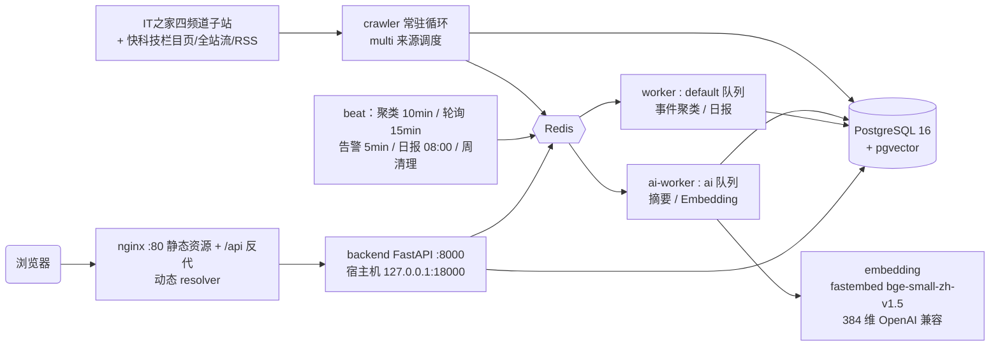

# 华军科技资讯雷达 V2.1 技术开发文档

版本：V2.1（2026-09-10 修订，对齐代码现状；V2.0 原始技术方案见 git 历史）

## 1. 技术目标

- 稳定运行：7×24 常驻采集与任务流水线，全服务健康检查、降级可观测
- 秒级响应：热点榜单 DB 内排序归一化，列表分页，前端增量刷新
- 支持多来源扩展：采集层来源插件化（频道真相口径各自声明）
- 支持 AI 处理任务：LLM 与内置算法双模式，断崖降级不阻断流水线
- 安全可信：多租户权限、审计哈希链、生产启动自检

## 2. 总体架构

| 服务 | 职责 | 关键约束 |
| --- | --- | --- |
| `backend` | FastAPI REST API | 端口仅绑 127.0.0.1；`/health` 探活（`?deep=1` 深度探测） |
| `crawler` | 常驻循环采集 → 入库 → 派发 AI 任务 | 每轮写心跳文件，间隔×3+5min 无心跳判 unhealthy；Redis 锁与手动任务互斥 |
| `worker` | Celery default 队列：事件聚合 / 日报 | `-c 4 --max-tasks-per-child=100`（防内存碎片） |
| `ai-worker` | Celery ai 队列：摘要 / Embedding | `-c 2`；Embedding 失败指数退避重试（30s→600s×5） |
| `beat` | 定时调度 | 聚类 10min / 互动轮询 15min / 告警巡检 5min / 日报每日北京 08:00 / 周清理 03:30 |
| `embedding` | 本地语义向量服务（override 合并） | fastembed(ONNX) + BAAI/bge-small-zh-v1.5，384 维，免鉴权，模型缓存于卷 |
| `postgres` | 业务数据 + pgvector 向量 | 不发布宿主机端口 |
| `redis` | 缓存 + Celery 队列 + 限速/告警状态 | 数据卷持久化 |
| `nginx` | 唯一公网入口 | `resolver 127.0.0.11` 动态解析（backend 单独重建不 502）；覆写 X-Real-IP；CSP Report-Only 等安全头 |

## 3. 技术栈

- **后端**：Python 3.12 · FastAPI · SQLAlchemy · Celery · pydantic-settings · bcrypt（手封装，cost 12）· jieba · pytest
- **数据**：PostgreSQL 16 + pgvector · Redis 7
- **AI**：OpenAI 兼容 LLM（可选）· 内置 TextRank v2 抽取摘要 · fastembed + BAAI/bge-small-zh-v1.5 语义向量
- **前端**：React 18 · TypeScript 5 · Vite 5 · Tailwind 3 · react-router 6（HashRouter）· lucide-react · vitest
- **部署**：Docker Compose（9 服务）· nginx · json-file 日志轮转（10m×3）

## 4. 采集管道（backend/app/crawler/）

### 4.1 IT之家（ithome.py）

- 四频道映射官方子站：Win11=win11 / Win10=win10（+/tags/ 兜底）/ 软件之家=soft / 智能时代=next.ithome.com
- **页面即频道真相**：只收频道页出现的文章，不做关键词归类；已入库文章频道变化自动纠正（rechannel）
- 健壮性：403/429 域名级指数退避（30min→2h）；窗口 14 天；未来时间拒收；正文清洗剥广告/致谢；SAVEPOINT 单篇插入防并发冲突

### 4.2 快科技（mydrivers.py，2026-09 接入）

- 入口（2026-09-10 修正）：栏目页 windows.html / ruanjian.html 升为**主入口**（官网编辑维护的栏目真相列表；全站流单页仅覆盖半天到一天，栏目文大多发布后即滚出）+ 全站最新流 technewsall（广度兜底）+ 官方 RSS「软件相关」feed（深度兜底，实测滞后 27h+ 且不含 Windows 文）
- **面包屑即频道真相**：详情页面包屑剔除首页/资讯中心后须恰两级，且在白名单内才入库；白名单 = 快科技「软件之家」大类全部二级栏目 `{桌面系统, 电脑软件, 移动应用, 手机系统}`，与 IT之家软件之家频道口径对齐；页面顶部全站推荐位靠白名单兜底过滤，不做容器级解析以抗改版
- 本期不启用阅读数（量纲差异），互动字段全 0、不参与轮询

### 4.3 互动数据轮询（stats.py）

- IT之家评论数 + 点赞数（阅读数无公开读取通道，恒 0）；`source=="IT之家"` 过滤
- 分层衰减节奏：0–2h 每 30min → 2–12h 每 1h → 12–48h 每 3h → 48h–14d 每 12h → 停采
- 失败退避 15min×2ⁿ（上限 2h），连续 6 次放弃；单篇提交，失败绝不覆写已有数据

### 4.4 调度（multi.py / loop.py）

- 同一把 crawler 锁内顺序采集各来源，单源异常隔离（独立 rollback），失败标 `degraded`
- 常驻循环每轮动态读 `crawler_interval_minutes`（面板热调立即生效），心跳文件供健康检查

## 5. AI 管道（backend/app/ai/）

### 5.1 摘要（summary.py）

- LLM 模式：OpenAI 兼容协议，temperature 0.2，json_object，输出 `{summary, points, tags}`
- 降级模式：TextRank v2 抽取式（Mihalcea-Tarau 句图 + PageRank d=0.85 + 标题覆盖与导语位置加权 + MMR λ=0.7 选 5 句）
- 每次调用恰好落一条 usage 记账（success / api_fail / parse_fail 三态）

### 5.2 Embedding（embedding.py）

- API 模式：OpenAI 兼容 `/embeddings`；strict 模式（默认）下失败/维度不符抛错交 Celery 重试，**绝不静默降采样污染聚类**
- 本地兜底：字符 n-gram 符号哈希（md5 落桶 ±1）+ sublinear TF + L2，256/384 维可配
- 成功写入 API 向量后把 `model|dim` 指纹存 system_setting，指纹漂移触发面板告警提示全量重嵌（scripts/reembed_all.py）
- cosine/centroid 维度不一致显式抛错（防向量来源混杂）

### 5.3 事件聚类（event_cluster.py + services/event_service.py）

**三段式相似度门槛**（`similarity_gate_pass`，模糊带宽度 HIGH_BAND=0.04）：

| 相似度带 | 关键词 Jaccard 要求 | 来源要求 |
| --- | --- | --- |
| 低位 `sim < 0.85` | — | 不合并 |
| 模糊带 `0.85 ≤ sim < 0.89` | ≥ 0.2 | **必须跨来源**（合并后 ≥2 来源） |
| 高位带 `sim ≥ 0.89` | ≥ 0.1（HIGH_BAND_KW_FLOOR） | **必须跨来源**；同来源一律不并（压制 Win11 同栏目模板文形态） |

- 标定依据：bge-small-zh-v1.5 真实向量上同事件对 ≥0.94，同域不同事件基线可达 0.90+；真实数据校准 177 篇 / 3000 随机负例对，正例 14/14 全过、负例拦截率 99.97%
- 聚类主流程：时间倒序贪心最近质心 + 时间窗（默认 48h，回看窗 96h）→ 并入已有事件走同一门槛 + 事件区间相邻校验 → 成员重叠救援分支须 max 成员相似度 ≥ 阈值 → 事件级二阶段合并（先共享成员去重再两两同门槛合并，多者吞并少者）
- 关键词集合预计算（免 O(n²) jieba 分词）；autoflush=False 下新增关联显式 flush（防质心滞后一轮）
- 事件状态机：≤6h 发酵中 / ≤24h 持续关注 / >24h 已平息；事件热度 = 成员 HotScore 之和（SQL 下推重算）；LLM 事件总结失败降级为事实拼装

### 5.4 热度算法（algorithms/hot_score.py）

- `HotScore = Engagement × TimeDecay`；`Engagement = views + comments×4 + likes×2 + shares×6`（权重可配）；`TimeDecay = e^(−0.0075×小时)`；Engagement=0 降级 `decay×100`
- 同一公式提供 SQL 表达式 `hot_score_expr` 供 DB 内排序，`scripts/verify_hot_score.py` 对拍双实现数值一致性；榜单归一化以窗口内全频道最大分为基准（切频道分数稳定）

### 5.5 软件日报（services/report_service.py / report_push.py）

- 口径：生成北京时间当天的发布期刊，文章与 AI 成本均取前一个北京时间自然日 00:00–发布日 00:00 的完整窗口；PG advisory lock 防同日并发
- 期号幂等：`issue_no` 自 `REPORT_ISSUE_EPOCH=2026-04-15` 起算，同日重复生成同行同期号（集成测试覆盖跳日 +N）
- 内容装配：TOP5 事件、昨夜今晨热榜 TOP10（2026-09-19 由 TOP5 扩容）、热点速览（热榜 TOP10 后 8 篇）、行业变化（剥导语壳/切转述连接词）、频道/来源统计、日报窗口 AI 成本；统计口径全部限定日报窗口内
- 推送：企业微信 markdown 卡片 + 飞书文本早报（2026-09-19 简化改版，同日晚间扩容排版：问候语 + 早报速览 10 条，❶~❿「标题：一句说明」，事件优先、热榜增量补位；刊头含收录数、尾部品牌·期号落款；HMAC-SHA256 签名可选）；配置优先级 面板 DB > .env > 关闭；推送失败不影响日报落库

## 6. 数据模型（11 表）

| 表 | 说明 | 关键字段 |
| --- | --- | --- |
| `article` | 文章 | url(unique)、channel、source、publish_time、views/comments/shares/likes、互动轮询三列（polled_at/next_poll_at/fail_count）、`embedding Vector`、`ai_status`（pending→summarized→embedded→clustered） |
| `article_summary` | AI 摘要（1:1） | summary_short/long、key_points(JSONB)、tags(JSONB)、model |
| `event` | 热点事件 | title、summary、impacts(JSONB)、hot_score、first_time/last_time、status、timeline(JSONB)、`centroid Vector` |
| `event_article` | 事件-文章关联 | unique(event_id, article_id) |
| `daily_report` | 日报 | date(unique)、issue_no、content(JSONB：overview/top_events/quick_news/industry_changes/channel_stats/ai_cost…) |
| `task_run` | 任务执行记录 | name、trigger(auto/manual)、status(running/success/**degraded**/failed/stale)、duration_ms、detail |
| `ai_usage_log` | AI 调用账单（无外键，独立财务记录） | task_type、model、prompt/completion/cached/total_tokens、latency_ms、status、cost(入库时锁定) |
| `model_price` | 模型价目 | model(PK)、price_input/output/cache（每百万 token 元；cache NULL=按输入价） |
| `app_user` / `tenant` | 用户 / 租户 | email(unique)、password_hash、role(super_admin/tenant_admin/member)、status、must_change_password、failed_attempts/locked_until；租户只隔离人员，资讯数据全局共享 |
| `user_session` | 服务端会话 | token_hash(sha256, unique)、expires_at、last_seen_at、ip、revoked_at |
| `audit_log` | 审计日志（无外键） | user_email、action、detail(JSONB)、ip、user_agent、**prev_hash/row_hash 哈希链** |
| `system_setting` | 运行时配置覆盖 | key(PK)、value；另借用存 embedding 指纹 |

## 7. API 清单（/api/v2，共 40+ 端点）

| 分组 | 端点（方法 GET 除注明外） | 鉴权 |
| --- | --- | --- |
| 探针 | `/health`（`?deep=1`） | 公开 |
| 业务读 | `/stats`、`/hot/board?window=24h\|3d\|7d\|all&channel=`、`/articles/latest?channel=&q=&limit=&offset=`、`/article/{id}`、`/article/{id}/summary`、`/events?limit=&offset=&status=&q=`、`/events/{id}`、`/report/daily?date=`、`/report/dates` | 登录 |
| 认证 | POST `/auth/login`（IP 限速+锁定）、POST `/auth/logout`、`/auth/me`、PUT `/auth/me/password`、`/auth/sessions`、POST `/auth/sessions/revoke-others`、DELETE `/auth/sessions/{id}` | 登录 |
| 租户/用户 | `/admin/tenants`、POST `/admin/tenants`、PUT `/admin/tenants/{id}`、`/admin/users`（分页）、POST `/admin/users`、PUT `/admin/users/{id}`、POST `/admin/users/{id}/password-reset`、POST `/admin/users/{id}/unlock` | 租管+（越权一律 404） |
| 运维 | `/admin/status`（10s 缓存，`?fresh=1`）、`/admin/task-runs`、GET/PUT `/admin/config`、POST `/admin/test/llm`、POST `/admin/test/embedding`、POST `/admin/crawl`、`/admin/events`、`/admin/stats`、`/admin/report` | 超管会话或 X-Admin-Token |
| 用量成本 | `/admin/usage/summary`、`/admin/usage/logs`、`/admin/usage/export`（CSV 防公式注入）、GET/POST `/admin/usage/prices` | 超管 |
| 审计 | `/admin/audit-logs`（多维筛选）、`/admin/audit-logs/export`（上限 10 万行）、`/admin/audit-actions` | 超管 |

## 8. 认证与安全

| 机制 | 实现 | 参数 |
| --- | --- | --- |
| 会话 | HttpOnly Cookie（`hjradar_session`，SameSite=Lax），令牌只存 SHA-256 | 绝对 TTL 模板 168h（代码兜底 72h）；空闲超时默认 24h（0=关闭）；>60s 才 touch 写库 |
| 密码 | bcrypt cost 12 + 弱口令封锁表（NIST SP 800-63B）+ 禁含邮箱本体 | 输入上限 72 字节；≥8 位强度校验 |
| 登录锁定 | 账号级原子自增计数 | 5 次失败锁 15min；不存在邮箱也跑同成本 bcrypt（防用户枚举）；成功登录轮换新会话（防会话固定） |
| IP 限速 | 固定窗口计数，Redis NX 定窗，失败退进程内 | 30 次 / 300 秒；成功清零（NAT 不连坐）；429 带 retry_after |
| CSRF | 变更方法须 JSON + `X-Requested-With` | 路由级依赖全覆盖 |
| 权限链 | require_user → tenant_admin → super_admin | 租户停用每请求实时查 403；`must_change_password` 服务端兜底只放行 /auth |
| 应急后门 | `X-Admin-Token`（hmac.compare_digest） | 仅等效 `/api/v2/admin/*` 前缀；虚拟主体 `admin-token` 留痕；错 token 记审计 |
| 审计哈希链 | `row_hash = sha256(prev_hash ‖ 行内容规范化 JSON)` | 写路径 PG advisory lock 串行化；`scripts/audit_chain_verify.py` 离线校验 |
| 越权留痕 | admin 域 403 / 无效 Token 记 `auth.access_denied` / `invalid_admin_token` | 同操作者+路径 5 分钟去重 |
| 生产 fail-fast | `_assert_production_safe` | production 下 cookie_secure / 关 docs / 关免鉴权 / 非默认 DB 口令任一不合规拒绝启动 |
| SSRF 守卫 | `assert_public_http_url` | LLM/Embedding 地址仅公网 http(s)；`ALLOW_PRIVATE_AI_URLS` 内网豁免 |
| 租户护栏 | 停用租户须无启用超管 | 停用/迁移/停用用户/改密/重置均即时吊销相关会话 |
| 传输与头 | backend 仅绑 127.0.0.1；nginx 覆写 X-Real-IP/XFF | CSP Report-Only、nosniff、X-Frame-Options、Referrer-Policy；CORS 显式白名单 + allow_credentials |

## 9. 可观测性与运维

- **任务留痕**：`record_task_run` 上下文管理器（running → success/degraded/failed；超 6h running 清扫为 stale）；面板任务表含降级黄标
- **节奏心跳**：事件 10min×3 / 采集 45min（或间隔×3）/ 轮询 15min×3 / 日报 26h×1，超时出告警条（beat 停摆感知）
- **告警巡检**：beat 每 5 分钟；Redis/Worker 不可用、任务停摆、失败未恢复、连续 3 轮 degraded → webhook（ok→bad 立即推、bad 每 30min 重提、恢复推送）；状态机存 Redis
- **配置体系**：`system_setting` 表覆盖 .env，面板 28 个可调键带区间校验与 bool 严格拼写；7 个敏感键脱敏（明文不回传，留空=不修改，审计只记「已变更」）
- **清理**：beat 每周一 03:30 清过期会话 / 超 180 天审计 / 超 90 天 task_run
- **运维脚本**（backend/scripts/，17 个）：init_db、manage_user（建超管/重置密码）、audit_chain_verify（哈希链校验）、audit_api / audit_auth（API 与认证验收）、reembed_all、sim_report（聚类标定）、verify_hot_score（热度双实现对拍）、repair_data / repair_impacts / rechannel_articles 等数据修复

## 10. 部署

- `docker compose up -d --build` 一键上线 9 服务；全部服务带 healthcheck（backend 走 /health 查库、beat 探 /proc 排除自身、crawler 看心跳文件、nginx 走本机反代链路）
- 日志轮转 json-file 10m×3 防磁盘撑爆；postgres/redis 数据卷持久化
- 生产检查单（`.env.example` 末尾，production 启动自检强制）：换 POSTGRES 密码 → 同步 DATABASE_URL → 换强 ADMIN_TOKEN → BOOTSTRAP 引导后移除 → ADMIN_NO_AUTH=false → COOKIE_SECURE=true → ENABLE_DOCS=false

## 11. 测试与验收

- **后端 pytest 177 用例**：171 离线（SQLite 内存库 + 依赖覆写，bcrypt 降 cost）+ 6 容器内 pgvector 集成（独立 `hjradar_test` 库，`TEST_DATABASE_URL` 未设置自动跳过）；覆盖聚类门槛（含真实负样本回归）、认证权限矩阵、usage 记账、日报口径与期号幂等、hot_score 边界、快科技解析回测（含白名单口径与栏目页入口哨兵）、运维巡检
- **前端 vitest 10 用例**：client 映射保留 eventIds/aiStatus、事件关联双口径（后端优先/缓存反推）、aiStatus 三态文案、事件 ID 路由兼容（`3`/`e3`）、加载更多去重（文章/事件）
- **验收脚本**：`scripts/audit_api.py`（全端点遍历）、`scripts/audit_auth.py`（权限矩阵/锁定/会话吊销/CSRF）
- **验收标准**：AI 摘要准确率人工抽检；事件聚合同事件合并率达目标（负例拦截 ≥99%）；系统 7×24 稳定运行（心跳/告警值守）

## 12. 开发计划

### V2.1（已交付，2026-09）

- 快科技数据源、语义向量 + 三段式聚类门槛、事件级合并
- 软件日报双通道推送、期号幂等
- 认证多租户 + 审计哈希链 + 生产 fail-fast
- AI 成本看板、运维监控（心跳/告警/degraded/热配置）
- 全面审计整改四轮（P0/P1 全清，见 docs/审计整改落实清单.md）

### V2.2（规划）

- 多来源扩展（极客公园/少数派/36氪/爱范儿/InfoQ，复用频道真相口径插件化接入）
- 周报与趋势分析
- 前端 E2E（Playwright）
- 推送渠道扩展（钉钉/邮件）
